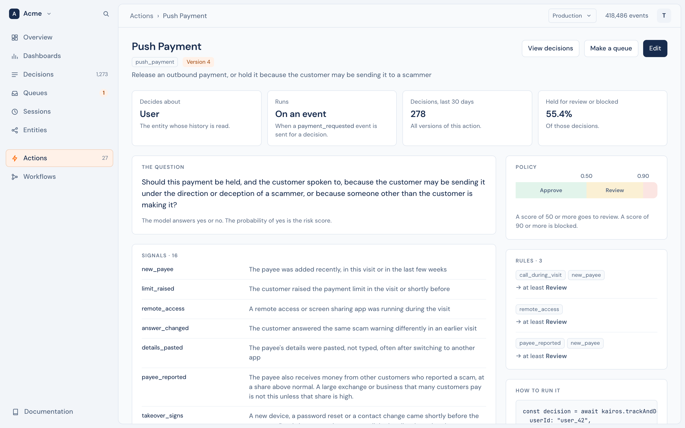

# Actions

An action is a decision you want made, defined in plain language: "should this bank transfer be held?", "should this merchant be approved?". You define it once, and then ask for a [decision](decisions.md) each time it comes up. There are no rules to write by hand and no features to engineer: you say what you are afraid of, and the policy on top is yours, and exact.



An action has a **key**, such as `bank_transfer`, that your code uses, and a **display name**, such as "Bank Transfer", that people see.

## Define an action

```ts
await kairos.defineAction("bank_transfer", {
  displayName: "Bank Transfer",
  subject: "user",
  hold: "Should this transfer be held because the account shows signs of fraud, takeover or being used to pass on other people's money?",
  reasons: {
    new_device: "The request comes from a device the user has not used before",
    new_payee: "The money goes to a payee added shortly before the request",
  },
  typologies: {
    legit: "An ordinary payment by the owner of the account",
    account_takeover: "Someone who is not the owner is using the account",
    mule: "The account receives money from other people and passes it on",
  },
  policy: { block: 0.9, review: 0.5 },
});
```

```python
kairos.define_action("bank_transfer", {
    "displayName": "Bank Transfer",
    "subject": "user",
    "hold": "Should this transfer be held because the account shows signs of fraud, takeover or being used to pass on other people's money?",
    "reasons": {"new_device": "The request comes from a device the user has not used before"},
})
```

`defineAction` is safe to call each time your service starts: the same definition changes nothing. In the console, **Actions › New action** starts from a blank form or from one of the [templates](../templates/overview.md). With the API, it is [`PUT /v1/actions/:name`](../reference/api.md#put-v1actionsname).

## The fields

| Field | | |
|---|---|---|
| `subject` | required | The entity type the decision is about, such as `user` or `merchant`. Its history is what the model reads. |
| `hold` | required | One yes-or-no question. Yes must mean "hold". The model's probability of yes is the risk. |
| `reasons` | | Signals to look for, as code → description. Each is judged on its own, and the ones found come back with the decision. |
| `typologies` | | Explanations that exclude each other, as code → description. The most likely one comes back. |
| `policy` | | How the answers become an outcome. See [Policy](#policy). |
| `trigger` | | An event type that starts the action. See [How an action runs](#how-an-action-runs). |
| `automatic` | | With a `trigger`: decide each matching event in the background. |
| `context` | | What the model is shown, beyond the defaults: recent events, totals, link types. |
| `displayName`, `description` | | For people. The model does not see them. |

## Write the question

- **Yes must mean "hold".** "Should this transfer be held because …?", not "Is this transfer safe?".
- **Name what you are afraid of.** "…because the account shows signs of account takeover, of money mule activity, or of the customer being a scam victim" works better than "…because it is risky".
- **Name the action.** "the pending bank transfer", so that the model does not confuse it with earlier transfers in the history.

## Signals and typologies

The model never sees the codes, only the descriptions. `new_device` tells it nothing; "The current session uses a device that the account did not use before" tells it everything.

- **Reasons** are independent. Write one fact per reason; several can be true at once.
- **Typologies** are the opposite: exactly one is chosen, so make them exclusive, and **include one for "nothing wrong"**. Without it, the model must pick a bad explanation for a good customer.
- Give each list at least two entries.

## Policy

The model answers with probabilities. The policy turns them into one of four outcomes, in order of severity: `approve`, `step_up`, `review`, `block`.

```json
"policy": {
  "block": 0.9,
  "review": 0.5,
  "rules": [
    { "id": "new_device_and_payee", "allOf": ["new_device", "new_payee"], "outcome": "step_up" },
    { "id": "drained", "when": [{ "total": "money_out", "op": ">=", "value": 5000 }], "outcome": "review" }
  ]
}
```

1. **Thresholds.** A hold probability at or above `block` is **block**, at or above `review` is **review**, otherwise **approve**.
2. **Rules.** A rule fires when every reason in `allOf` is present, and every comparison in `when` holds. A rule can only make the outcome **more severe**, never less. `step_up` comes only from a rule.

The server makes the comparisons, so a rule is exact every time. The default thresholds, 0.9 and 0.5, are placeholders: hard cases often score well below 0.5 while still ranking above normal ones. Set them from your own outcomes with a [backtest](decisions.md#decide-as-of-a-past-moment).

## Totals

A model reads one number well and adds up fifty badly. So an action can ask the server to calculate **totals** over the subject's events, and to make the comparison:

```json
"context": {
  "totals": [
    { "name": "money_in", "event": "deposit", "sum": "usd", "window": "7d", "usual": "90d", "covers": "usd" }
  ]
}
```

The model then reads "money in during the last 7 days: 9,000 from 2 events, 34.2 times a usual week, and it covers all of this withdrawal". A total has a period (`30m`, `24h`, `7d`, `session`, or all history), optional conditions in `where`, a comparison with the usual period in `usual`, and the share of the request it covers in `covers`. Totals read every event in their period, so they are also how old history reaches a decision.

**Pair a total with a rule.** A total makes the model report the right signals, but the outcome changes when a rule acts on it, for example `{ "total": "money_in", "is": "times_usual", "op": ">=", "value": 10 }`. Totals are facts for a judgement, not a balance check: check the balance in your ledger.

## Context options

| Option | Default | |
|---|---|---|
| `recentEvents` | 30 | How many of the subject's most recent events the model sees in full, 1 to 500. |
| `reasonThreshold` | 0.5 | A reason comes back when its probability is at or above this. |
| `linkTypes` | every type that links | The entity types that count as [links](links.md). |
| `totals` | none | Up to 8. See [Totals](#totals). |

## How an action runs

| In the console | How |
|---|---|
| **On request** | Your server calls `decide` when the action comes up. |
| **On an event** | The action has a `trigger`, such as `bank_transfer_requested`. One call, `trackAndDecide`, stores the event and returns the decision. A trigger can name statuses, such as `{ "event": "transaction", "status": "pending" }`, for a [record that changes](events.md#records-that-change). |
| **Automatically** | With `automatic: true`, Kairos also decides each matching event that your server sends, or that an inbound webhook brings, in the background, and sends the decision to your [webhooks](../platform/webhooks/outbound.md). Events from a public key, events more than an hour old, and events from before it was turned on are never decided. |

One event starts at most one action. A [workflow](../platform/workflows.md#decision-request) can also make an action's decisions, with steps of its own.

## Versions

A change to anything the model reads, the question, a reason, a typology, the policy or the context, is a new **version**, because it can change the answers. Each decision records the version that made it, such as `bank_transfer@2`. A change to the display name, the description or `automatic` alone is not a new version.

**Keep the wording fixed once you tune it.** New wording can move the scores and the thresholds you chose. Compare versions on the same cases before you switch: a decision can ask an earlier version, as `bank_transfer@1`.

## Limits

| | |
|---|---|
| Reasons, typologies | 2 to 255 each, each description different |
| Totals | 8 for each action |
| Recent events in full | 1 to 500 |
| Names of actions, reasons and typologies | Start with a letter or an underscore, then letters, digits and underscores, up to 64 characters |
