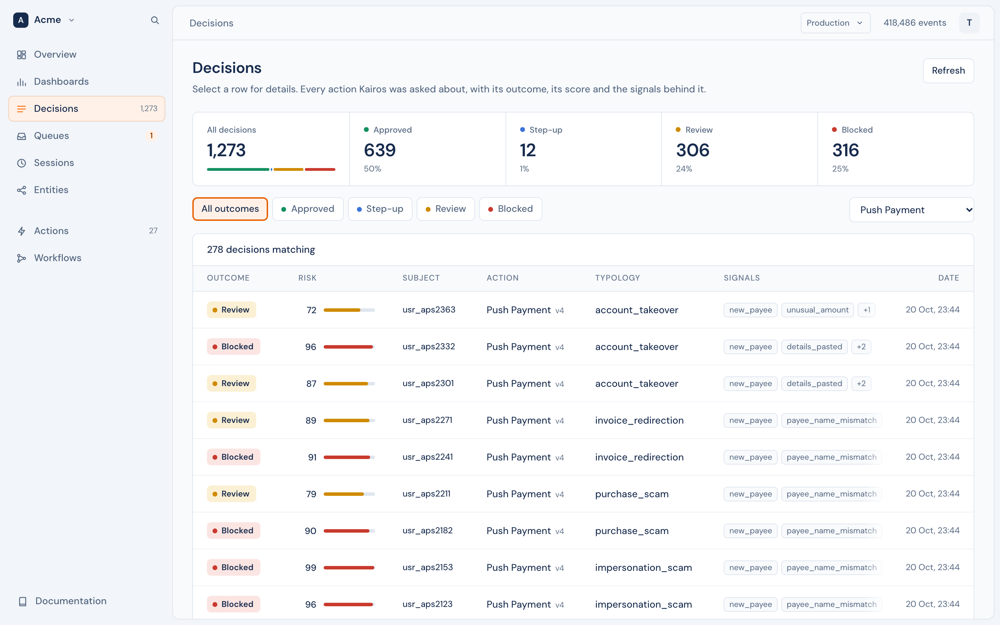
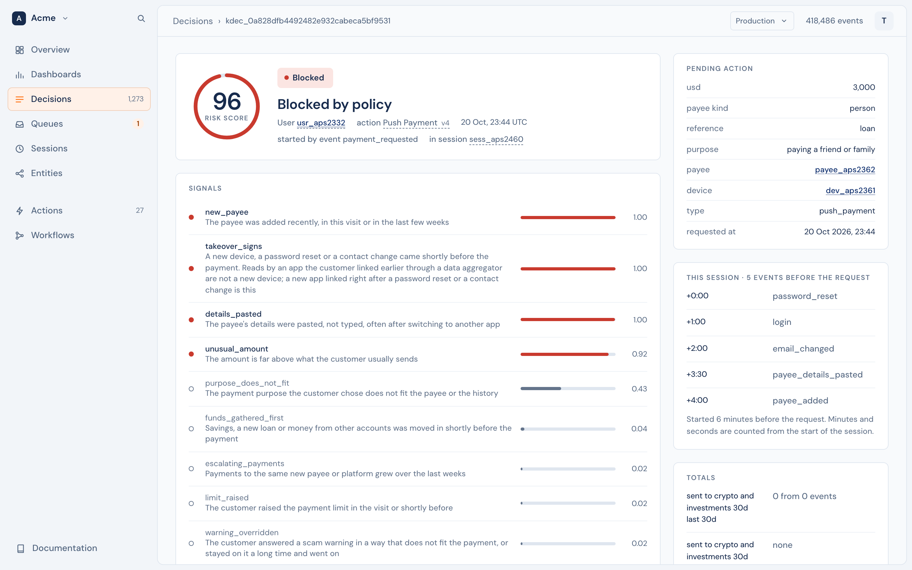

# Decisions

A decision is one answer to an [action](actions.md): approve, step up, review or block, with a risk score and the signals behind it. You ask at the moment of action, and Kairos answers in a few hundred milliseconds. Every decision is stored with exactly what the model was shown and what it answered, so that you can always see why.



## Ask for a decision

Name the action, its subject, and every entity the action involves: they are what Kairos checks for [links](links.md).

```ts
const decision = await kairos.decide(
  { type: "bank_transfer", userId: "user_42", payeeId: "payee_new", deviceId: "dev_9", amount: 2400, currency: "GBP" },
  { fallback: "review" },
);

if (decision.decision !== "approve") {
  // hold it: decision.riskScore, decision.reasons
}
```

```python
decision = kairos.decide("bank_transfer", {"user_id": "user_42", "payee_id": "payee_new", "amount": 2400}, fallback="review")
```

With the API, [`POST /v1/decide`](../reference/api.md#post-v1decide) takes `action`, `entities`, `properties` and `session`.

`decide` sends your queued events first, so the decision sees everything you tracked before the call.

### Decide from an event

When the request is itself an event, such as `bank_transfer_requested`, give the action that event as its `trigger`, and one call stores the event and returns the decision:

```ts
const decision = await kairos.trackAndDecide("bank_transfer_requested", { userId: "user_42", payeeId: "payee_new", amount: 2400 }, { fallback: "review" });
```

The request is then always in the history, the event and the decision cannot disagree, and the decision records the event that started it. Sending the same event id again returns the same decision, so a retry is safe. With the API, it is [`POST /v1/events/decide`](../reference/api.md#post-v1eventsdecide).

An action can also decide [automatically](actions.md#how-an-action-runs), in the background, and send the decision to your webhooks.

## What you get back

| Field | |
|---|---|
| `decision` | `approve`, `step_up`, `review` or `block` |
| `riskScore` (`risk_score`) | The hold probability × 100, rounded |
| `probability` | The probability that the action should be held, 0 to 1 |
| `reasons` | The signals judged present |
| `typology` | The most likely explanation, when the action has typologies |
| `rules` | The policy rules that fired |
| `action` | The action and the version that decided: `bank_transfer@2` |
| `decisionId` (`decision_id`) | The id of the stored decision. Store it with your transaction. |
| `fallback` | `true` when Kairos could not answer and you got your fallback |

`reasons` are not an explanation of the score. Each is a separate judgement of whether a signal is present, so a decision can have a low score and several reasons: that is when a policy rule is useful.

## How a decision is made

1. Kairos reads the subject's history: its most recent 2,000 events, its properties and its labels.
2. It builds the context: the most recent events in full, a summary of the older ones, the current session, and the action's totals.
3. It looks one step out: for each other entity in the request, how many other subjects share it, how many are new, and how many carry a label such as `fraud_confirmed`, against the normal rate.
4. It asks the model the action's question, and each of its signals and typologies.
5. It applies the action's policy, and stores the decision.

See [Overview](../getting-started/overview.md#how-a-decision-is-made) for the details.

## When Kairos cannot answer

`decide` has a time limit: 3 seconds by default, covering retries. Choose what happens when it runs out, for each action:

```ts
await kairos.decide(input, { fallback: "review" }); // fail closed: a person looks at it
await kairos.decide(input, { fallback: "approve" }); // fail open: let it through
```

With a fallback, `decide` always answers, with `fallback: true` and the error that caused it; log both. Without one, it throws. `timeoutMs` (`timeout=` in Python) changes the limit for one call.

## See why

A decision opens in the console, from **Decisions** or from its id in the command menu, to everything that led to it: the risk score and the outcome, each signal with its probability, the request, the current session, the totals, the recent events, the linked entities, and the exact input and answer of the model.



When a decision surprises you, this is where you look: most surprises are explained by what was, or was not, in the context. With the API, [`GET /v1/decisions/:id`](../reference/api.md#get-v1decisionsid) returns the decision with `context` and `raw`.

## Resolve a decision

A person can record the true outcome of a decision, approve or block, after a review:

- In the console, on the decision's page, or by resolving a [case](../case-management/cases.md) that holds it.
- With the SDK: `kairos.resolve(decisionId, "block", { note: "Confirmed with the customer" })`.
- With the API: [`POST /v1/decisions/:id/resolution`](../reference/api.md#post-v1decisionsidresolution).

The model's decision stays on record. The decision gets a `resolution` and a `final_outcome`, and your [webhooks](../platform/webhooks/outbound.md) get `decision.updated`. To teach later decisions, also add a [label](entities/README.md#labels) to the subject: the decision's page has two buttons for that, **fraud_confirmed** and **cleared**.

## Decide as of a past moment

A decision can be made as of a past moment: it then sees only the events and the labels up to that moment. This is how you test a change to an action on history before you use it:

```ts
const decision = await kairos.decide({ type: "withdrawal", userId, usd }, { timestamp: requestedAt });
```

Load the history with its real times, add the outcomes with the times they became known, decide each past request, and compare the decisions with what happened to choose your thresholds. A decision as of a past moment starts no workflow and opens no case.

## Get good decisions

- **Do not rely on the 0.5 threshold.** Set `review` from your own outcomes, with a backtest.
- **Use rules on reasons for the cases the score misses.** Read the reasons of your missed cases: the pattern is usually there. Keep rules narrow, with two or three reasons together.
- **Track text and the ordinary events.** A sentence the customer wrote decided more cases than anything else in testing, and a history of ordinary behaviour is what makes the unusual visible.
- **Send labels both ways**: confirmed fraud and cleared cases.
- **Name the entities in `decide`.** A decision can only check links for the entities it is told about.

## The decision log

[`GET /v1/decisions`](../reference/api.md#get-v1decisions) lists decisions newest first, filtered by outcome, final outcome, action, subject or session. In the console, **Decisions** has the same filters, kept in the address.
