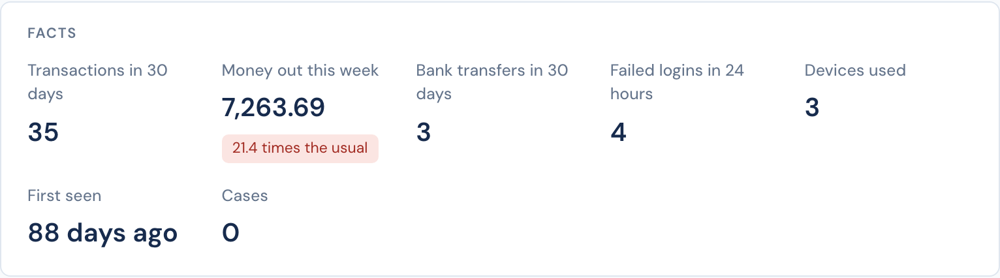

# Facts

A fact is one number from an entity's history, worked out when a person looks: "35 transactions in 30 days", "7,263.69 out this week, 21.4 times the usual", "3 devices used", "first seen 88 days ago". An [entity type](README.md#define-a-type) can have up to 12 facts, and every entity of the type shows them.



## Where facts show

- **The entity's page**, under its header, in **Entities › a type › an entity**.
- **Case pages** about the entity, beside the details, so that a reviewer sees the numbers without leaving the case. A case [layout](../../case-management/layouts.md#facts-and-lists) can choose which facts to show, and can add its own.

A fact is worked out when the page opens, up to now. It is for people: a decision does not read it. To give a decision a number, use an action's [totals](../core-concepts.md#totals).

## Set up a fact

**Entities › a type › Edit definition › Facts.** Each fact is one line that says what it shows; click it to change it.

| Part | |
|---|---|
| Count from | Events that name the entity, decisions about it, its labels, or its cases (in the queues you can see). |
| What | How many; the total or the average of a number property (the risk score, for decisions); how many different entities of a type the events name, such as devices; when the first or the last one was. |
| Filters | Event types and a property value for events, such as `transaction` with `direction` = `out`; the action and the outcomes for decisions; a label; case statuses. |
| Over | The last 24 hours, 7, 30 or 90 days, a year, or all time. |
| Compare with the usual | For a count or a total over a period: what a period of the same length usually held, over a longer period before it. "21.4 times the usual" stands out from 3 times. |
| Show as | A number, money in a currency, or a percent. |

The name beside a fact, such as `money_out_7d`, is what case layouts use. It follows the label until the definition is saved, and does not change after.

When you define a new type, **Start from a template** fills in facts for `user`, `device`, `merchant` and `beneficiary`. In the definition of any type, **Select from templates** under the facts adds the facts of one of these templates; **Preview** shows them first. Change any of them after.

## With the API

Facts are part of the type's definition, in [`PUT /v1/entity-types/:type`](../../reference/api.md#put-v1entity-typestype):

```json
{
  "facts": [
    {
      "name": "money_out_7d",
      "label": "Money out this week",
      "source": "events",
      "measure": "sum",
      "field": "amount",
      "filters": { "event_type": "transaction", "property": { "name": "direction", "value": "out" } },
      "window": "7d",
      "usual": "90d",
      "format": "money",
      "currency": "GBP"
    }
  ]
}
```

[`GET /v1/entities/:type/:id/facts`](../../reference/api.md#facts-and-lists-of-an-entity) returns each fact of one entity with its value, and with `usual` and `times_usual` when the fact compares with the usual.

See also: [Lists](lists.md), the tables of an entity's records.
