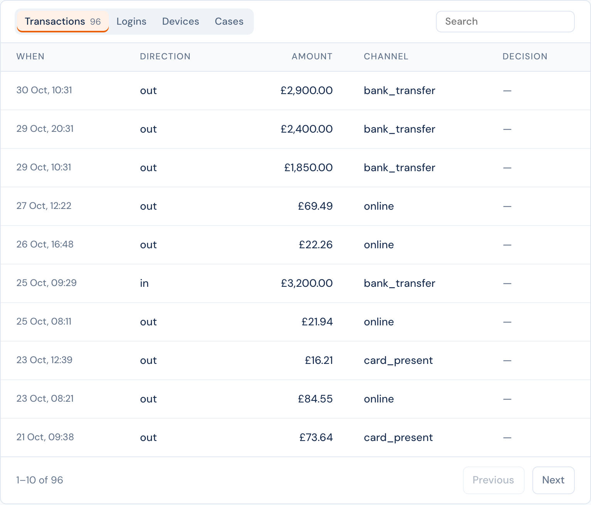

# Lists

A list is a table of the records about an entity, page by page: all its transactions, its logins, the devices it used, its cases. An [entity type](README.md#define-a-type) can have up to 6 lists, and every entity of the type shows them, a tab each.



## Where lists show

- **The entity's page**, in one card with a tab for each list, 10 rows to a page.
- **Case pages** about the entity, 5 rows to a page. A case page **marks the rows that belong to the case**: the transaction that opened it, the device it named. A case [layout](../../case-management/layouts.md#facts-and-lists) can choose which lists to show, and can add its own.

Each tab has a search and keeps its own page. **Click a row** to see it in full in a window, without leaving the page: the event and the decision it started, the decision, the linked entity, or the case. The window links to the record's own page.

## Set up a list

**Entities › a type › Edit definition › Lists.** Each list is one line that says what it shows; click it to change it.

| Part | |
|---|---|
| Show | Events that name the entity; decisions about it; linked entities of one type, which share events with it (optionally only events of some types); or its cases. |
| Filters | Event types and a property value for events; the action and the outcomes for decisions; case statuses. |
| Over | The last 24 hours, 7, 30 or 90 days, a year, or all time. |
| Order | Newest first, or oldest first. |
| Columns | At most 12, in order. Each source has fixed columns (when, the decision's outcome and risk score, an id, a linked entity's name and how many events it shares) and its properties (`event.amount`, `request.country`, `entity.os`). |
| Show as | For each column: text, a number, money (in a fixed currency, or the currency of another field such as `event.currency`), a date, yes or no, or a country. |

The name beside a list, such as `transactions`, is what case layouts use. It follows the label until the definition is saved, and does not change after.

When you define a new type, **Start from a template** fills in lists for `user`, `device`, `merchant` and `beneficiary`. In the definition of any type, **Select from templates** under the lists adds the lists of one of these templates; **Preview** shows them first, with their columns. Change any of them after.

## With the API

Lists are part of the type's definition, in [`PUT /v1/entity-types/:type`](../../reference/api.md#put-v1entity-typestype):

```json
{
  "lists": [
    {
      "name": "transactions",
      "label": "Transactions",
      "source": "events",
      "filters": { "event_type": ["transaction"] },
      "columns": [
        "ts",
        "event.direction",
        { "field": "event.amount", "label": "Amount", "format": "money", "currency": "event.currency" },
        "decision.outcome"
      ],
      "sort": "newest",
      "window": "all"
    }
  ]
}
```

[`GET /v1/entities/:type/:id/lists/:name`](../../reference/api.md#facts-and-lists-of-an-entity) returns one page of rows, with `limit`, `offset` and a search `q`.

See also: [Facts](facts.md), the numbers about an entity.
