# The console

The console is the web interface of Kairos, at [kairos.finic.ai](https://kairos.finic.ai). It is where you see every decision and why it was made, work the cases that need a person, and set up actions, workflows and your workspace.

## Find your way

The sidebar has the pages of the workspace; **Settings** has its own sidebar, with **Back to dashboard** at the top.

- **The environment menu**, at the top right, switches between Production and your sandboxes. Every page, key and webhook you see is of the selected environment. See [Environments](environments.md).
- **The workspace menu**, at the top left, changes workspace, makes a new one, and opens Settings.
- **Search**, or ⌘K (Ctrl+K), opens the command menu. It goes to any page, action, queue or entity type, changes the environment, the workspace or the theme, and opens one record when you type its id, such as `user/user_42`, a decision id or a case id.
- **Your avatar**, at the top right, has your profile, Settings, light or dark, and Sign out.

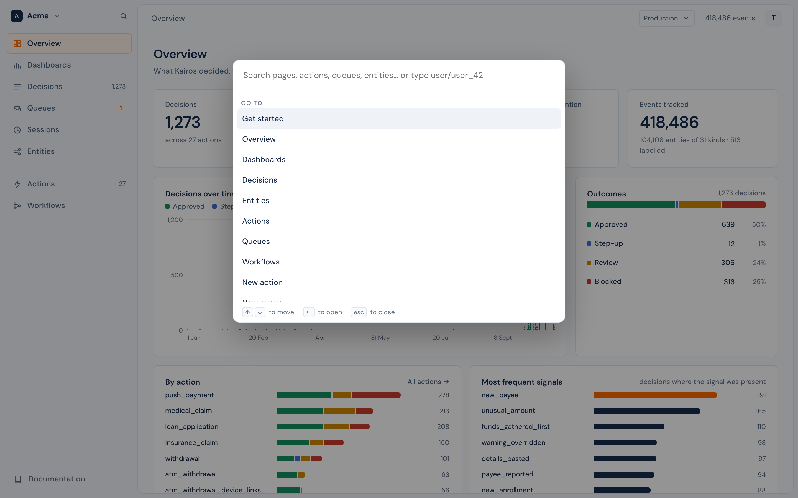

## Get started

The first page of a new workspace. It lists the steps to connect your app, and marks each one done from your own data: send a first event, define an action, get a first decision, then describe an entity, record an outcome, build a dashboard and invite your team. It has a prompt to give a coding agent, and it watches for your first event and decision as they arrive.

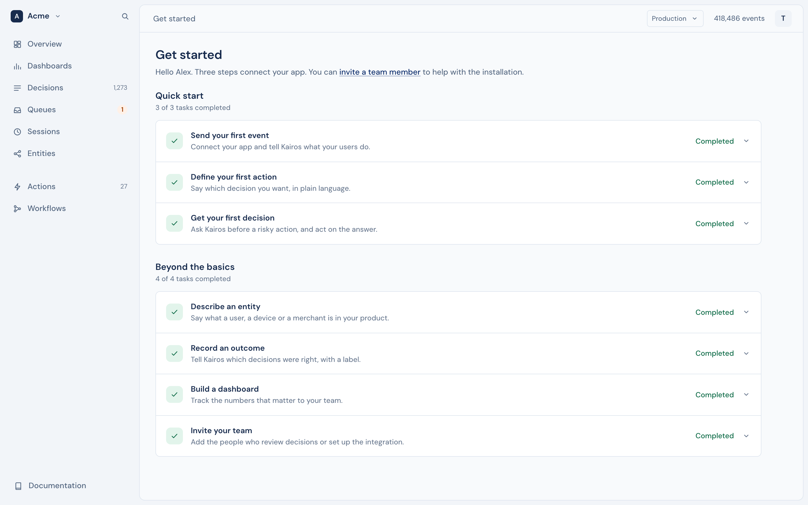

When every step is done, or you remove the page with the × beside it, the workspace opens on **Overview**.

## Overview

What Kairos decided, what it is holding, and what is driving it: counts, decisions over time, outcomes, decisions by action, the most frequent signals, the spread of risk scores, and the decisions that need attention.

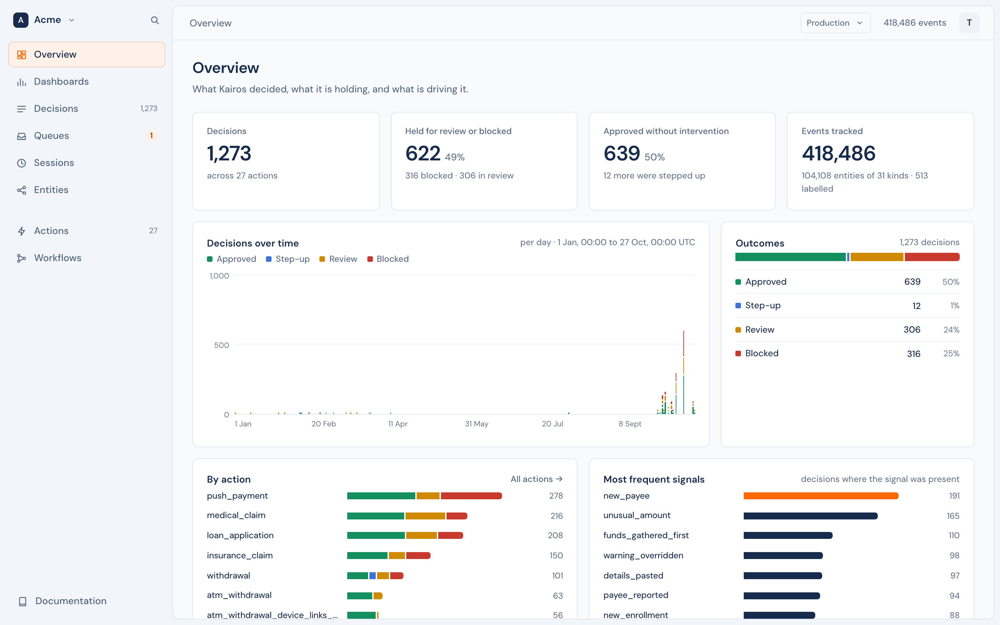

## Dashboards

Pages of tiles that you build. Each tile is one number about decisions, events or labels, shown as a number, a line, bars, a table or a list of recent decisions, over the last 24 hours, 7, 30 or 90 days. A dashboard is yours alone, or visible to the workspace. **Edit layout** moves and resizes tiles. See [Dashboards](dashboards.md).

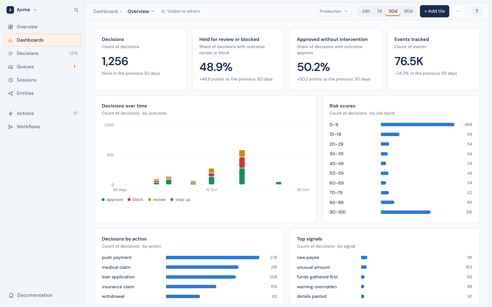

## Decisions

Every decision, with its outcome, risk score, subject, action, typology and signals. Filter by outcome and by action; the filters are in the address, so you can share a filtered list.

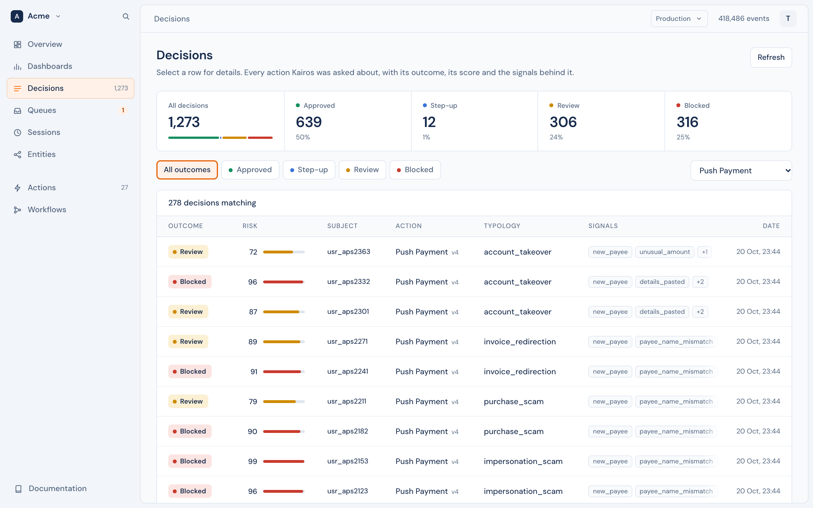

### One decision

A decision opens to everything that led to it: the risk score and the outcome, each signal with its probability, the request, the current session, the totals, the recent events, the linked entities, and the exact input and answer of the model. Two buttons record the true outcome as a label.

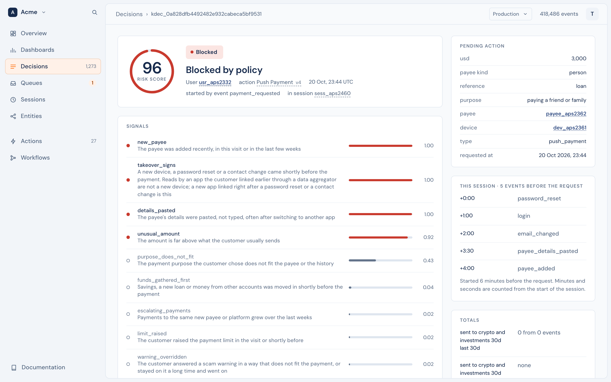

## Queues and cases

A queue is a list of work for people, such as "Onboarding review". Its rules open a case for each decision that needs a person. The queue shows its cases with tabs for each status, filters for priority, assignee and due time, and boxes to assign or resolve many at once. See [Queues](../case-management/queues.md).

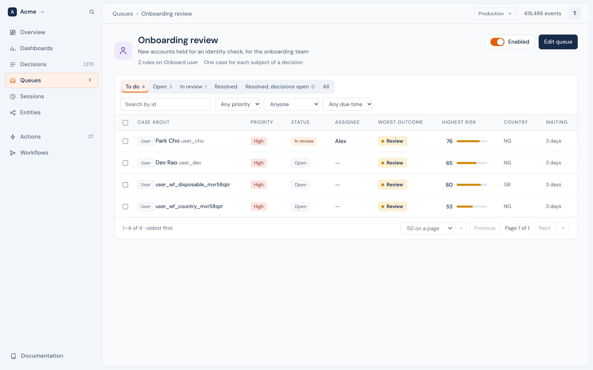

A case opens to why it exists, its decisions, the facts and lists of its entity, its details and what happened. **Assign**, **Resolve** and **Reopen** are at the top, and every step is in its activity. A queue can have its own [layout](../case-management/layouts.md) for its cases. See [Cases](../case-management/cases.md).

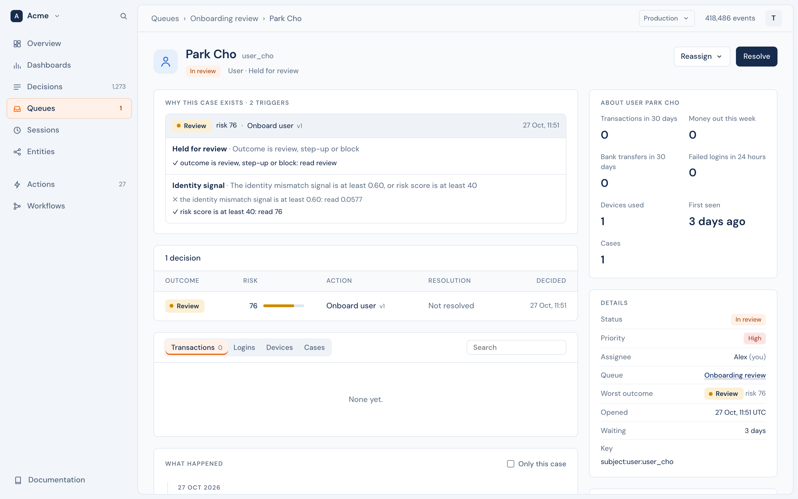

## Sessions

One row for each visit of a person: who was in it, the most severe outcome decided in it, its events, and when it was last active. A session opens to a replay that plays its events and decisions in order, as a timeline or on a device. See [Sessions](../concepts/events.md#sessions).

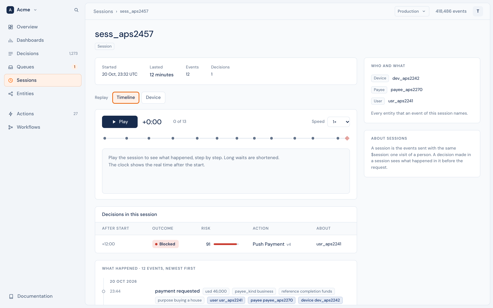

## Entities

The entity types, then the entities of one type, then one entity. The list filters by id, label, the latest decision and its risk score, the last activity and the entity's own properties. **Import** loads a file of entities, and **Edit definition** changes the type. An entity's page has its [facts](../concepts/entities/facts.md) and [lists](../concepts/entities/lists.md), its properties, labels, decisions and event history. See [Entities](../concepts/entities/README.md).

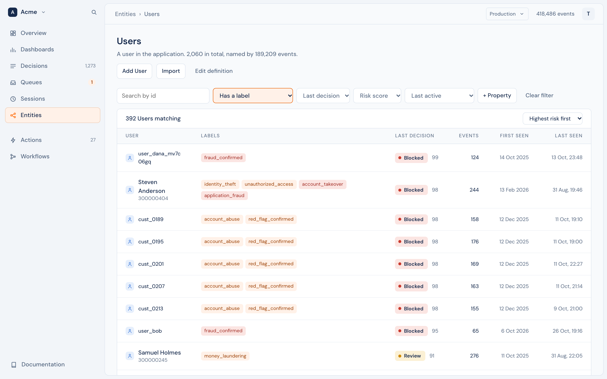

## Actions

Each decision you defined. An action opens as a page to read: what it decides about, when it runs, its decisions and held share for the last 30 days, the question, the signals, the typologies, the policy, the rules, and the code that calls it. **Edit** saves a new version; **Make a queue** starts a queue for its decisions.

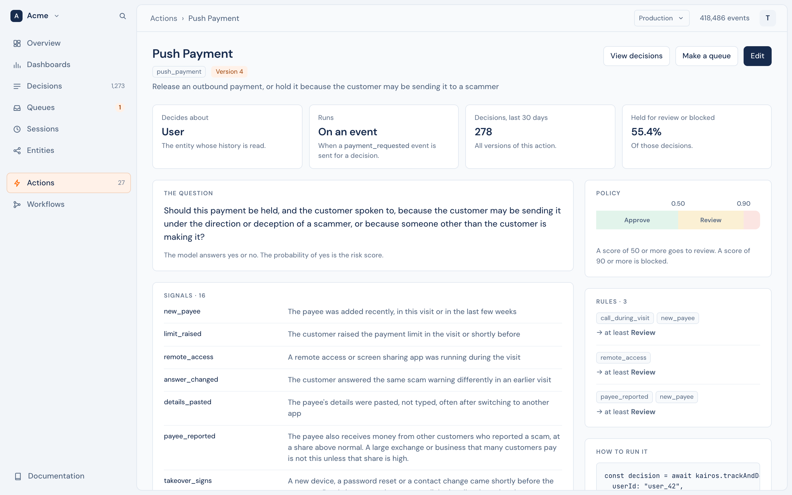

## Workflows

Each workflow, its builder, and its runs. The builder shows the workflow as a diagram, from its trigger through each step and branch. **Add a step** adds one, and **Publish** makes the draft live. See [Workflows](workflows.md).

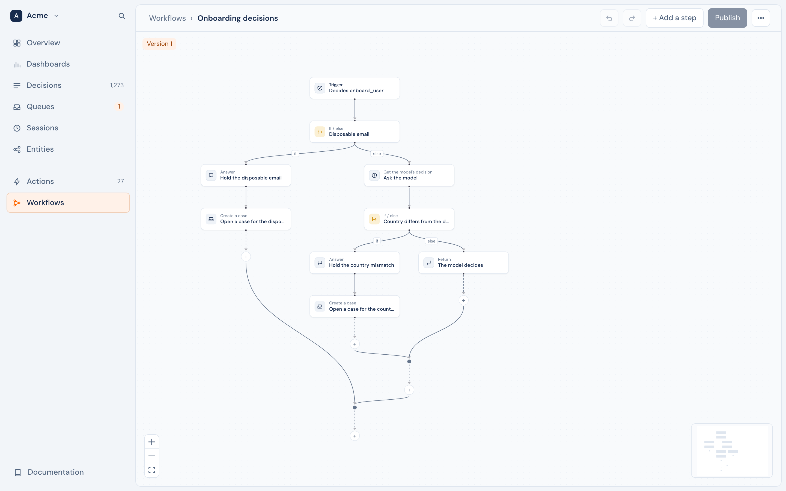

## Settings

Settings has your account, the workspace, and the developer tools of the selected environment.

- **Profile** and **Preferences**: your name and the theme. You can also delete your account.
- **General** and **Members**: the workspace's name, and its people and their roles. See [Workspaces](workspaces.md).
- **Environments**: Production and your sandboxes. Make a sandbox, copy data into it, rename it or delete it. See [Environments](environments.md).

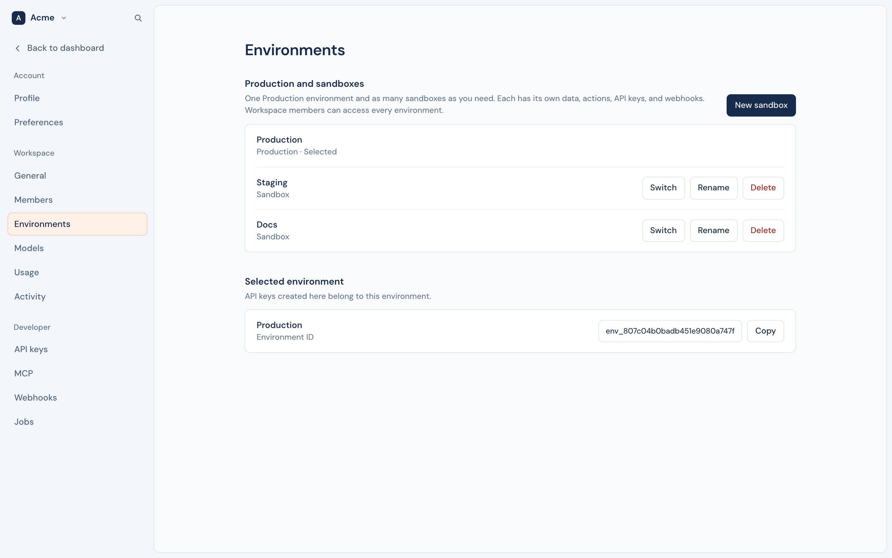

- **Models**: the built-in model and the scoring models you uploaded. See [Models](models.md).
- **Usage**: events, decisions and model tokens for each day.
- **Activity**: what people did in the workspace. An admin sees the whole team, and a member sees their own.
- **API keys**: keys for your servers and apps. See [Authentication](authentication.md).
- **MCP**: let agents connect, and choose what they can do. See [MCP](../reference/mcp.md).
- **Webhooks**: messages to your systems, and from your providers. See [Outbound](webhooks/outbound.md) and [Inbound](webhooks/inbound.md).
- **Jobs**: the background work of the environment. A failed job can run again.

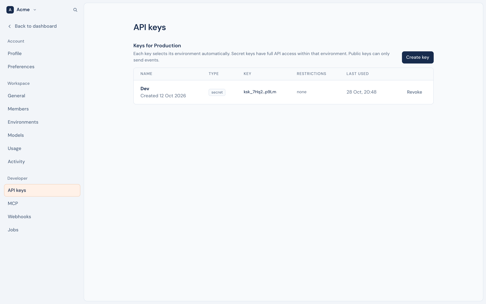
